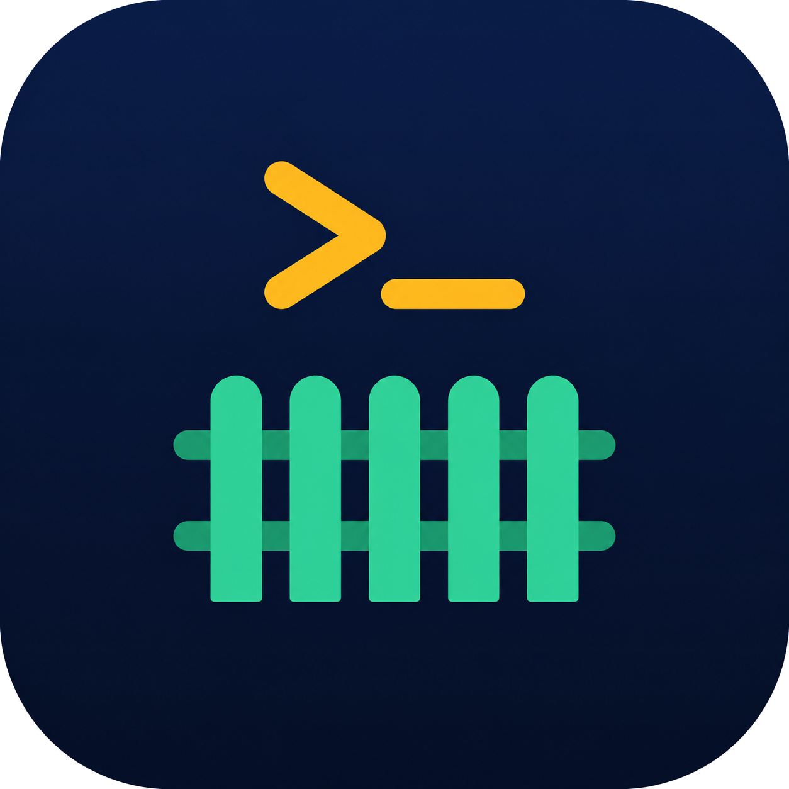

<p align="center"></p>

<p align="center"><a href="README.md">简体中文</a> ｜ <strong>English</strong></p>

# zcode-fence

**A deterministic fence plugin for ZCode: catastrophic-command gate + project write fence. Windows-first, works on all three platforms, ask-only, zero dependencies (Node ≥ 16).**

When you run ZCode in "full access" mode, what you need is not another permission level but a **deterministic pre-flight guard**: if the AI accidentally runs `rm -rf C:/Users` or writes files to your desktop/home, ask first. The same command always gets the same verdict — pure rule matching, no AI judgment, no network activity by default, no third-party dependencies. When you want coverage for semantic risks rules cannot decide statically, an optional decision-model review layer can be enabled explicitly.

## What it guards against: real accidents on Windows

Drive-letter paths, Git Bash path styles, Windows environment variables, the real temp directory — the things most easily missed by macOS-minded tools are foundation-level here:

| Scenario | zcode-fence behavior |
| --- | --- |
| `rm -rf C:/Users` / `echo x > C:/Users/x/pwn.txt` (drive-letter paths, either slash style) | ask |
| `echo x > "C:/Users/…/f"` (quoted redirect target) | quotes stripped, then judged → ask |
| Git Bash / MSYS paths `/c/Users/...`, `echo x > /tmp/f` | normalized to `C:\Users\...`; `/tmp` maps to `%TEMP%` (temp writes pass) |
| Variable paths `%USERPROFILE%` / `$HOME` / `%TEMP%` | expanded before judgment |
| `del /s /q C:\Users\x`, `format D:`, `Remove-Item -Recurse C:\`, `reg delete` on root hives, `cipher /w:`, etc. | built-in rules → ask |
| Compound commands `a && b & c\nd` (incl. single `&`, newlines) | fully split and judged per segment — later segments cannot escape |
| Wrapper-hidden commands: `env -i rm -rf /`, `sudo -u root rm -rf /`, `nice -n 10 …`, `timeout 10 …`, `stdbuf -o0 …`, `bash -lc '…'` | option chains and combined short switches are peeled, then judged → ask |
| `find / -delete`, `find / -exec rm -rf {} +`, `xargs rm -rf`, `sed -i … /etc/passwd`, `awk 'BEGIN{system(…)}'`, interpreter shell payloads | ask |
| `curl … \| bash`, `bash <(curl …)`, `eval "$(curl …)"` | ask (remote code execution) |
| Irreversible git: `git push --force`, `git reset --hard`, `git clean -fdx`, `git branch -D` | ask (even inside the project) |
| System persistence: `crontab -r`, `systemctl enable`, `reg add`, `schtasks /create`, disabling the firewall | ask |
| `rm -rf node_modules`, `mv src/a.ts src/b.ts`, in-project `chmod +x`, `git status` | pass (zero-false-positive philosophy) |
| Runtime | pure Node (ZCode is an Electron app; node is always present), zero deps, works on a default Windows setup |

## What it does / does not do

Two independent deterministic layers, plus an optional decision-model review layer that is off by default:

1. **Danger gate** (`enable_danger_gate`): token-level exact combination matching, catastrophic-only — `rm -rf /`, `rm -rf ~`, `del /s /q C:\Users\x`, `format D:`, `dd of=/dev/sda`, `mkfs`, `diskutil eraseDisk`, fork bombs, `--no-preserve-root`, `chmod -R` on root/home, PowerShell `Remove-Item` on drive roots/home, `reg delete` on root hives, `cipher /w:`, `vssadmin delete shadows`, power commands (`shutdown`/`reboot`, `systemctl poweroff`), `bcdedit` writes, `diskpart`, etc. It also sees through payloads hidden inside `trap`/`eval`/`$()`/backticks or behind control-flow keywords such as `then`/`do`, and through interpreter `-e`/`-c` payloads (`node -e`, `python -c`) whenever a write API and an absolute-path literal co-occur (e.g. `node -e "…rmSync('C:/Windows'…)"`). v1.4.0 adds: wrapper option chains and combined short switches; `find -delete`/`-exec` judged by search root; dynamic `xargs` deletion targets; `sed -i` file operands; shell payloads from `awk system()`, `php -r`, `deno eval`, `bun -e` and `osascript`; `curl | bash` / `bash <(curl)` / `eval "$(curl)"` remote execution; `mount`/`umount`/`fdisk`/`parted` changes; irreversible git operations (force/delete/mirror push, `branch -D`, `reset --hard`, `clean -fdx`, change-discarding checkout/restore, `stash clear/drop`, etc.); and system persistence (crontab, iptables flush, firewall off, `reg add/delete`, `sc delete`, `systemctl enable/disable/mask/unmask`, `launchctl load/unload/bootstrap/bootout`, `schtasks /create|/delete|/change`). Custom regex rules supported.
2. **Project fence** (`enable_fence`): file writes are limited to **writable roots** = project root (host-injected `ZCODE_PROJECT_DIR`) + the **real temp dir of the current platform** (`TEMP`/`TMP` on Windows; `TMPDIR` with `/tmp` kept on Unix) + the ZCode project memory directory (`~/.zcode/cli/memories`, written frequently by the host memory feature, allowed by default) + user-configured extra roots. Bash commands are judged heuristically (redirect targets, destination positions of cp/mv/tar/curl/tee..., every path operand of `chmod`/`chown`, both source and destination of `mv`, `sed -i` file operands, the deletion root of `find`, path literals co-occurring with write APIs inside interpreter payloads); `cd`/`pushd`/`popd` inside a command update the current directory for later segments, and relative write targets are resolved against it before comparing with the project/memory/extra roots (the temp directory only accepts absolute paths); file tools (Write/Edit/ApplyPatch) get exact judgment (realpath with per-segment ancestor walk against symlink smuggling).

**Session-root locking** (`lock_session_root`): the host-injected project root actually tracks the Bash current directory — once the agent `cd`s into a subdirectory, every subsequent call (Write/Edit included) drifts along, and `cd`-ing out of the project disables the fence entirely. With locking on, each session is judged against the **first root it saw** (≈ the workspace the session opened in): cd-ing into a subdirectory no longer flags writes to the real project root, and writes after cd-ing out stay fenced. State lives in a single `session-roots.log` in the plugin data directory (one line per session, 30-day expiry, 200-entry cap).

**Optional decision-model review layer** (`enable_decision_model`, off by default): only when both deterministic layers stay silent, the tool name, command or file path, and the project root are sent to the configured decision model, which is asked one question — should the user confirm? — plus an effect category (read-only, project write, git history, data deletion, system change, external side effect, data exfiltration). The model can only produce ask or silence; confirmation fires when the probability reaches the threshold (default 0.6). Timeouts (default 3500 ms, capped at 4000 ms), network errors, invalid responses or a missing endpoint fail open without changing the deterministic verdict, and the outcome is written to the decision log. Before sending, API keys/tokens/passwords/Authorization headers/private-key blocks/long secrets are redacted; only the tool name, command/path and project root are sent — never file contents, conversation history or session memory. Endpoint, model, API key, threshold, timeout, headers, proxy and prompt are all configurable; the source hardcodes no vendor endpoint.

**Zero-false-positive philosophy**: routine in-project work (`rm -rf node_modules`, `mv src/a.ts src/b.ts`, `chmod +x src/script.sh`, ...) passes untouched; the plugin only cares about "catastrophe", "out-of-bounds" and "irreversible loss". Git is the deliberate exception: operations that can lose uncommitted changes, untracked files, remote branches/tags or history ask even inside the project.

**Non-goals (honest disclosure)**: this is not an OS-level sandbox. It inspects command text before execution; the following evade it by nature (it protects against accidents, not deliberate circumvention):

- encoded payloads (`powershell -EncodedCommand`), script file contents (`powershell -File x.ps1`, `node x.js`), writes whose payload carries no path literal (concatenation like `process.env.HOME + '/x'`, or a command assembled from variables and passed to `child_process` indirectly);
- sensitive-file reads/exfiltration (SSH private keys, `.env`, cloud credentials);
- network access (ZCode's plugin API cannot control it).

Relative out-of-bounds writes are not in this list: in-command cwd tracking judges `cd /c/Users/x && touch y`; relative targets are only allowed under the project/memory/extra roots, so use an absolute temp path for temp files.

## ask-only: only tighten, never loosen (the key design decision)

A hook's `allow` only skips the host's routine confirmation — it can only make things looser, never safer. So this plugin **never emits `allow`** (and never `deny`): on violation it emits `ask`; otherwise no output and exit 0, handing control back to the host's own permission mode. `ask` takes precedence over the host mode — even under full access a confirmation dialog appears. The confirmation box is the elevation channel: approve once, pass once.

| Host mode | Normal in-project ops | Dangerous cmd / out-of-bounds write | Net effect |
| --- | --- | --- | --- |
| Full access (main scenario) | silence = runs as usual | confirmation | full fence |
| Auto edit | silence = host default | confirmation (Bash already asks) | semantics unchanged, free out-of-bounds file-write protection |
| Confirm before changes | silence = host still asks each step | confirmation (overlaps host prompt) | equivalent to not installed |
| Plan mode | unchanged | unchanged | unchanged |

## Installation

**Option 1: local directory marketplace (development / personal use)**

1. ZCode → Plugins → Add marketplace → select this repo root (the repo root itself is the local marketplace via `marketplace.json`);
2. Install `zcode-fence` from that marketplace.

**Option 2: GitHub marketplace (once the repo is pushed to GitHub)**

1. ZCode → Plugins → Add marketplace → enter the repo URL `https://github.com/Momenttttt/zcode-fence`;
2. Install `zcode-fence` from that marketplace.

After either method, **start a new task** (hook config is snapshotted at task start; installs and config changes only take effect in new tasks), then ask the agent to run `echo x > C:/Users/<you>/Desktop/fence-test.txt` — a confirmation dialog means it works.

## Configuration

Configured in the ZCode plugin settings UI, persisted under `plugins.options["zcode-fence@<marketplace>"]` in `~/.zcode/cli/config.json`, **re-read on every tool call** (takes effect in new tasks after editing). The settings UI is a single-line input that strips newlines → all list-type values are semicolon-separated; regex segments must not contain semicolons.

| Key | Type | Default | Description |
| --- | --- | --- | --- |
| `enable_danger_gate` | boolean | `true` | Danger gate switch |
| `enable_fence` | boolean | `true` | Project fence switch |
| `lock_session_root` | boolean | `true` | Session-root locking: judge against each session's first-seen root and ignore cd drift — no false positives after cd-ing into subdirectories, no fence bypass after cd-ing out. State in session-roots.log |
| `custom_rules` | string | `""` | Custom danger rules: semicolon-separated JS regexes (case-sensitive), matched against the whole command text; invalid segments are skipped |
| `extra_writable_roots` | string | `""` | Extra writable roots: semicolon-separated, supports `~`, `$VAR`, `%VAR%`. Add the other folders of multi-folder projects here (the host provides no folder list, so they cannot be inferred) |
| `enable_log` | boolean | `true` | Decision log switch |
| `enable_decision_model` | boolean | `false` | Decision-model review switch (off by default; no network requests while off) |
| `decision_model_endpoint` | string | `""` | Full POST endpoint; must be https, or http on localhost/private networks |
| `decision_model_model` | string | `""` | `model` field in the request body; omitted when empty |
| `decision_model_api_key` | string | `""` | Bearer key; `ZCODE_FENCE_DECISION_MODEL_API_KEY` takes precedence |
| `decision_model_threshold` | string | `"0.6"` | Confirmation probability threshold, 0–1 |
| `decision_model_timeout_ms` | string | `"3500"` | Timeout in ms, capped at 4000 (hook total is 5000) |
| `decision_model_headers` | string | `""` | Extra headers, semicolon-separated `Name: Value` |
| `decision_model_proxy` | string | `""` | `http://` proxy; fall back to environment proxies, NO_PROXY/localhost bypass |
| `decision_model_prompt` | string | `""` | Optional override for the confirmation prompt |

## CLI self-test & decision log

Print verdicts without ZCode. stdout is byte-identical to hook output (the ask JSON, or empty when passing — safe for scripts to consume), while stderr gets a one-line human-readable summary (e.g. `decision=silent`) so you can eyeball the verdict while debugging:

```bash
export ZCODE_PROJECT_DIR="$PWD"
node plugins/zcode-fence/scripts/guard.js --eval 'rm -rf C:/Users'         # → ask (danger gate)
node plugins/zcode-fence/scripts/guard.js --eval 'echo x > "C:/Users/x/f"' # → ask (out of bounds)
node plugins/zcode-fence/scripts/guard.js --eval 'rm -rf node_modules'     # → silent
node plugins/zcode-fence/scripts/guard.js --eval-write 'C:\Users\x\Desktop\a.txt'  # → ask
node plugins/zcode-fence/scripts/guard.js --help
```

The decision log (on by default) writes one JSONL line per ask/silent/error to `~/.zcode/cli/plugins/data/zcode-fence@<marketplace>/decisions.log` (auto-rotates at 5MB) for after-the-fact auditing ("why wasn't that blocked?"). Invalid stdin or internal errors fail open (exit 0, no output) and are logged.

See [SKILL.md](plugins/zcode-fence/skills/zcode-fence/SKILL.md) for how the agent should respond to `[zcode-fence: ...]` markers: switch to an in-project/temp path or request user approval; never retry verbatim, never try to bypass.

## Security statement

- No network activity and no data collection by default; all deterministic decisions are local and auditable (decision log).
- Only when `enable_decision_model` is explicitly enabled are redacted tool-call details (tool name, command/path, project root) sent to the configured endpoint; file contents, conversation history and session memory are never sent.
- All rules are built-in and readable (`plugins/zcode-fence/scripts/guard.js`); no remote rule delivery.

## Development & testing

```bash
npm test   # node tests/unit.js && node tests/run.js && node tests/decision-model.js
```

- `tests/unit.js`: unit tests for normalizePath / splitting / token extraction / danger targets / config;
- `tests/decision-model.js`: a local mock HTTP server covers ask/silent/threshold/timeout/HTTP errors/invalid JSON/missing endpoint/redaction, with no external network access;
- `tests/run.js`: acceptance cases (`tests/cases.json`) all exercise the real entry points (`--eval` / stdin), with global invariants: **no case may ever produce allow/deny output** (ask-only is a project-level decision), ask output must exactly match the host schema, marketplace.json/plugin.json versions must stay in sync,
DEFAULT_CONFIG keys must match the manifest userConfig;
- CI: GitHub Actions tri-platform matrix (windows/ubuntu/macos + a node16 compatibility job).

Release reminder: bump `version` in `marketplace.json`, `plugins/zcode-fence/.zcode-plugin/plugin.json` and its Claude-compatible copy `plugins/zcode-fence/.claude-plugin/plugin.json` together (enforced by a test).

## License

[MIT](LICENSE) © 2026 zcode-fence contributors

Inspired by [XieZongChen/zcode-workspace-guard](https://github.com/XieZongChen/zcode-workspace-guard) (MIT); design ideas were also informed by [leepokai/jev-guard](https://github.com/leepokai/jev-guard), [kenryu42/cc-safety-net](https://github.com/kenryu42/cc-safety-net) and [openchamber/openchamber](https://github.com/openchamber/openchamber); ideas only, no code copied.
